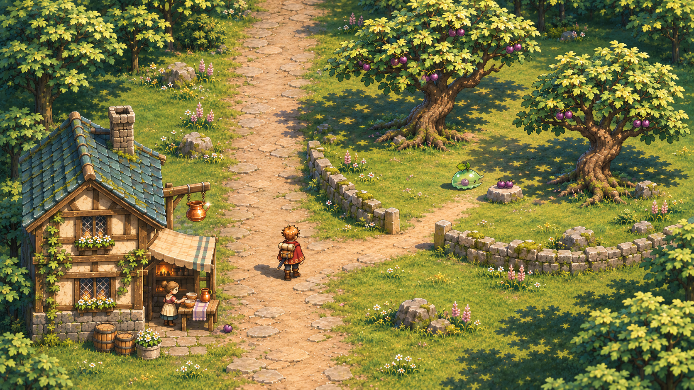

# Wanderstead（旅人之所）

> 游戏设计笔记 · v0.7
> 状态：宏观方向已定；§19「旅店外的李子」已成为第一个可玩小样。在根目录用 `cargo run --locked` 开始。
> 名称：暂定
> 创作署名：西幻日常、庇护与神战、多阵营构筑、四层成长及雾镇故事由项目作者提出。§10.4 分列雾镇原文与 AI 补写。矿井示例、《缺席的一季》及文中标作候选的具名神系、伙伴、任务与终局由 AI 拟写。
> 本轮署名：先做能独立成立的日式西幻，再逐次更新，是项目作者的开发方向。§19 的林边果树、纸面规则和概念图是 AI 助手据此提出的方案。

## 1. 游戏概念

一款融合传统 Roguelike、开放世界 RPG、长期角色养成、
队伍构筑、Idle 自动化与模块化据点经营的单机游戏。

玩家在程序化生成的开放世界中冒险，培养主角和伙伴，
探索随机地宫，收集装备、发展技能、经营据点。

玩家既可以亲自控制主角，也可以编写行为策略，
让队伍自主探索、战斗和成长。

熟路和战术练成之后，可以交给队伍自主执行。玩家腾出手探索更深的生境，也可以留在城里靠手艺谋生，经营住所，和熟悉的居民过日子。何时追究遇见的怪事，由玩家决定。

### 核心理念：成长与认识世界

**成长结构：个人构筑 → 队伍构筑 → 信仰与权柄构筑 → 国家与文明的成长。** 玩家能做的事，从练好一个人的本领，扩展到让一队人彼此配合，再到选择向谁立约、与谁分享力量，最终影响哪些地方能得到庇护。影响范围扩大后，弱小队友仍值得培养，据点仍是想回的家，一件稀有装备仍可能改变下一场战斗。四层如何相互推动，见 §15.5。

**叙事递进：西幻／日式西幻的日常 → 黑暗奇幻 → 更宏大的世界真相。** 初来时，玩家只知道受了伤可以去哪座神殿。后来，他认识了守住神殿的人，也认识了被留在结界外的人；再后来，他才有足够的亲身经验，追问连神也必须遵守什么规律。主线让他带着新的理解回到原处，有能力改变这些人的处境。三次重访怎样写进主线，见 §10.1。

### 核心体验支柱

1. 长期而持续的 RPG 成长。
2. 随机世界、随机能力与随机构筑。
3. 个体培养与队伍协同。
4. 可编程、可观察、可接管的自动化冒险。
5. 模块化据点与自动化生产。
6. 可持续深入的地宫与逐渐升级的挑战。
7. 重访熟悉的人和地方，用自己经历过的事重新理解世界。

---

## 2. 创作动机

### 喜欢的体验

- 复杂且具有长期耐玩性的角色养成。
- 在随机能力组合中寻找可行的发展路线。
- 通过技能使用、饮食等方式提升属性。
- 将弱小的角色长期培养起来。
- 研究装备、技能及队友之间的协同。
- 在越来越困难的地宫中持续挑战极限。
- 让复杂的生产、培养和战斗系统自动运行。
- 观察自己设计的策略逐渐发挥作用。

### 长期游玩的取舍

- 重要事件由作者编写；不同存档里的地理、当地势力和玩家选择，给同一事件留下不同的后果。
- 玩家决定队伍分工、配装和行动条件。熟路上的移动、逐个补给和常规训练交给策略执行。
- 已经攻克的地宫成为稳定收益，更深的生境保留挑战。远征失败要付出归返代价，长期养成的角色仍值得带回家。

### 设计原则

**保留系统深度，降低执行负担。**

复杂性应主要来自：

- 角色培养方向。
- 技能与装备之间的关系。
- 队伍构筑。
- 自动化行为策略。
- 资源生产与分配。
- 随机遭遇和长期发展决策。

---

## 3. 游戏类型与基础规则

### 3.1 类型定位

传统回合制 Roguelike RPG。

融合以下设计：

- 程序化世界与地宫探索。
- 长期、持久化的角色养成。
- 队伍式 RPG 战斗。
- 可编程 AI。
- 可观察的 Idle 自动化。
- 模块化据点经营。
- 随机任务与贯穿全局的主线剧情。

角色死亡采用有代价的复活，详见 §11。

### 3.2 行动驱动回合制

确定采用行动驱动回合制。

游戏世界时间由角色行动推进，
而非依靠真实时间持续流逝。

基本设想：

- 所有角色遵循统一的时间规则。
- 行动具有时间消耗。
- 允许不同角色具有不同的行动速度。
- 主角手动操作时，等待玩家输入行动。
- 自动状态下，系统连续执行角色行动。
- 玩家可以随时暂停自动执行并接管。

角色、敌人和 NPC 尽量复用相同的行动机制。

这种时间模型有利于：

- AI 行为决策。
- 战斗模拟。
- 行为脚本接口。
- 游戏状态复现与调试。
- 自动冒险的暂停和恢复。

### 3.3 世界时间与后台模拟

世界具有统一的游戏时间。

主角行动时，世界时间推进。

不在当前地图中的系统不必进行完整逐回合模拟。

例如：

- 当前地图：完整移动、战斗与 AI 模拟。
- 据点生产：根据经过的游戏时间结算生产进度。
- 远处的非活动区域：根据需要进行抽象事件结算。

据点居民的实际移动不参与生产逻辑。

目前不设计真实时间驱动的离线成长。

---

## 4. 世界结构

**这个世界有两个尺度。** 在游戏体验的尺度上，我初来乍到，知道怎样挣一顿饭钱，却不认识替我包扎伤口的人。后来我有了住处、手艺、朋友，出门冒险也有了想带东西回来的人。在世界观叙事的尺度上，问题是：这样寻常的一天，靠哪些自然条件、前人的选择和仍在出力的人才得以成立？对城里人可靠的常识，对深处的生命是否同样可靠？

西幻与日式西幻是表层质感：集市、工坊、神殿、冒险者与节庆都可以亲近。黑暗奇幻从看清庇护的代价开始；更宏大的真相，要能重新解释玩家亲手用过的力量、爱过的地方。做菜、布置房间、和朋友过节自有乐趣，其中许多事到结局也只具有私人的意义。

**已经选定的地理前提：** 远隔的地点在特定自然条件下本来就会相邻，两地可以直接步行往来。古代设施能观测、稳定或隔断这种通路。它是可反复验证的一条地理规律；深渊、神明和文明史还有更大的来由。

当前设想中，过去曾有多个魔法技术发达的文明，其中一个建造了遍布大陆的设施网络。
不同地区和时代的人用它运输、引水或开展研究，也曾封闭、改建或遗弃其中一部分。
灾变过后，王国、城镇和贸易路线已在漫长岁月中重建。城里人依然会维护有用的旧闸，
边地却留有失控的设施、危险的生态区域，以及连古人都没有测绘完的去处。
网络最初的用途、灾变的成因，以及二者之间有无因果关系，仍是开放问题。

**底层逻辑的要求：能解释设定，能支撑玩法，也能承载最终揭示。** 同一种变化要能在野兽的习性、地牢的险处、人的技艺和神迹里留下相互印证的后果。§4.6 写当代人赖以生活的秩序；§4.7 从创作者的角度给出首选解释；§5.5 写玩家怎样分辨这两层。

### 4.1 程序化开放世界

参考：

- Stoneshard 的随机大世界。
- Elona / Elin 的抽象世界地图。
- 传统 Roguelike 的局部区域与地宫结构。

每个存档生成独立的世界。

世界地图包含：

- 地形与生态区域。
- 道路。
- 城镇与聚落。
- 地宫入口。
- 特殊地点与遗迹。
- 主线相关地点。
- 其他随机兴趣点。

世界生成后，其宏观地理结构在存档内保持稳定。

不同存档具有不同的世界布局。

### 4.2 固定内容与随机生成结合

世界采用混合生成方式。

主线剧情、主要势力和部分重要地点可以使用预设内容。

但这些地点可以根据地理、距离等规则，
放置在每次生成的不同世界中。

世界生成需要保证：

- 重要地点能够合理放置。
- 主线需要的地点可以到达。
- 必要的道路与地点关系成立。

### 4.3 抽象世界地图

采用类似 Elin 的世界地图移动方式。

玩家在大地图上以格子或区域为单位旅行。

选中可进入的野外地块后，切换到局部场景探索。

世界地图移动可以涉及：

- 游戏时间消耗。
- 旅行资源。
- 地形差异。
- 随机遭遇。
- 地点发现。
- 探索信息与战争迷雾。

具体旅行规则尚未设计。

### 4.4 局部场景

局部场景使用 HD-2D 渲染。

包括：

- 野外地图。
- 城镇。
- 据点。
- 地宫。
- 特殊地点。
- 剧情场景。

普通野外根据地形类型和生成种子创建。

**城镇示例：白榆镇。** 火精灵在烤炉旁和面包师争论哪种柴好，兽耳学徒闻出药材里掺了薄荷，小教堂的门开着，旅人能进去喝水。玩家可以从公会找工作、为行商带货，或留下学一门手艺。不同族群能在一条街上过日子，是后期值得追究的历史；面包师今天挑剔薪柴，也可以单纯是因为他想把面包烤好。白榆镇的位置随存档生成，各种出身与信仰的角色都可以在这里谋生。

重要地点和据点具有独立的持久化状态。

普通野外可以在一段游戏时间后重新生成。

具体重置规则尚未确定。

### 4.5 快速旅行

世界具有可逐渐解锁的旅行网络。

可以通过交通设施或特殊地点连接已发现的区域。

可能的表现方式：

- 传送点。
- 商队。
- 轨道。
- 滑索。
- 特殊交通设施。

目前不确定具体形式。

系统层面只需要支持：

- 地点之间的连接。
- 解锁条件。
- 旅行时间。
- 旅行消耗。
- 可达性限制。

目标是减少已经熟悉的路线带来的重复操作，
同时保留探索未知区域的过程。

### 4.6 深渊、神格与庇护：当代人生活在什么秩序里

以下是本轮优先推演的设定。先区分当代人能确认的现象、他们对现象的解释，以及留给后半程的问题。

| 概念 | 能在世界中看到的事 | 这个区别有什么用 |
| --- | --- | --- |
| 深渊 | 边地把神域之外的许多陌生生境统称为深渊。从那里传来的变化会使熟田失收、人兽受害；同一环境中也可能有已经适应它的居民。 | 农户知道这一次必须撤离，却未必知道来者是捕食者、侵略者，还是同样需要逃难的邻人。「魔王」可以是一次入侵的真实领袖；击退它以后，土地为何仍在变化，是另一个问题。 |
| 权柄 | 一类能在特定条件下反复发生的奇迹。以「悲悯」为例：受难者重新获得希望时，可以开始自愈；施术者的头衔并不能制造这个条件。 | 写一项权柄，要写出它能改变什么、何时有效、即使神亲临也做不到什么。借用这项权柄的凡人技能和大范围神迹遵循同一条件，差在能影响谁、持续多久。 |
| 神格与神力 | 神格决定能承载哪种权柄、能把庇护伸到多远，也可能维系神的人格与尚未履行的旧约。神力是此刻可用的力量，能借燃料、供养或共同劳作恢复。 | 断供会让一位拥有完整神格的神无力赴援。夺取另一枚神格可迅速扩大能做的事，却补不上往后每个冬天的供给。继承者还要面对原神曾答应保护的人。 |
| 结界 | 诸神长期行使权柄，使一些地区在侵蚀中仍然可居。范围、持续时间和要庇护的生活条件会消耗神力。 | 收缩边界确实可能保住核心人口。援助、分担、兼并和等待邻神衰亡由此都有现实诱因；夺取神格是某些时代占优势的生存手段。 |

一张王国疆域图回答不了「谁在保护谁」。同一神殿可以接纳敌国的难民，却受本国官员管辖；忠于神意的神仆可能指证主教；一座富裕、安全的城仍可能不让外来者定居。异端医师也许真能延缓变异，其教团犯下的罪仍有具体受害者。写每个势力时，给它一个实际保护的对象，再找出谁承担了这份保护的代价、谁有权拒绝。百姓、行会和村社也能组织救济、传授技艺、与神殿谈条件。

容量能解释神**做不做得到**，承诺与性情才解释祂**愿意做什么**。候选神明白冠君主每逢冬祭解封战亡者的家书，连怨恨祂的话也原样交还。下过残酷军令的神，是同一位郑重替死者守信的神。即使库房充足，遗属仍有不原谅祂的理由。

### 4.7 创世未竟：宇宙真相的首选候选

这套解释从一句当代人普遍相信的话出发：「诸神在创世之后筑起结界，挡住世界之外的恶意。」城墙以内确实更适合人类生活；居民错估的是「创世之后」。大陆是一片较早稳定下来的天地，新的生命、材料及其相互依赖的方式至今仍在形成。豢养牲畜、改良粮种、让不同族群几代人吃得了同一锅饭，都是先民参与这段历史的方式。一株域外药草进神殿就枯萎，也许恰恰是庇护在正常起效：同一种环境救得了门里的病人，却养不活门外带来的药。

已选定的**天然相邻**解释远隔的生境怎么会相遇；**创世未竟**解释相遇的双方为什么有时能共居，有时会给彼此带来灾难。古代设施能维持或切断一次接触；造设施的文明出现以前，这个过程就已经在继续。地表所谓「深渊」里既有还在变化的前沿，也有早就活过几代、拥有自己历史的社群。

写进玩法时，力量从哪里来、由什么承载、在何种环境下有效、长期维持要付什么，都应当能从实际结果中辨认。多数城镇的生活条件已经相通，去邻城吃顿饭无需重配整队的护符。差异真正影响一个人、一件装备或一次行动时，再把选择交给玩家。

### 4.8 历史草案：同一段过去怎样留下不同证据

| 时期（候选） | 当时的人做了什么 | 今天还找得到什么 |
| --- | --- | --- |
| 初生年代 | 各种生境分别稳定，早期生命开始相遇。 | 不同年代的材料样本，以及尺度、用途都不合人类身体的遗址。 |
| 初灯年代 | 守护者学会把适宜的环境维持到下一季；许多聚落合力负担它。 | 最早神龛里的几种餐具和供物。今天供奉同一位神的人，祖先曾不能共食。 |
| 共居战争 | 争地、抵抗入侵和接纳逃难者发生在同一片边境。后来的几国都称当年的勇者是自己的先祖。 | 两军的阵亡册留下交战的日期；撤离者的通行记录留下了当天为平民开门者的名字。 |
| 列国年代 | 共同维护的设施被分给不同王国和修会，旧约有的延续，有的被删改。 | 仍响应敌国神龛的护符、被拆掉的祭坛构件，以及至今有人照办的地方习惯。 |
| 当代 | 边疆开发打开封闭区，兼并后的神又要承担原来的庇护；过去共同维护的人已经散去。 | 商路绕行、某地神术失效、邻城却仍照常开市。玩家可以改变的是有当事人、有起因的危机。 |

这份次序用来编写地方历史。古代设施最初为谁服务、灾变落在哪段历史中，仍留到能写出可靠的同时代证据时决定。

### 4.9 神、国家与跨境组织

王室能征税调兵，教会掌握诊所、祭仪与教学，神承担实际的庇护。三者的疆界并不重合。以下六组是**候选的神与社会样例**，用于推演一种权柄怎样进入职业、家庭和政治。雾镇的哭泣圣母、灰烬之主、凛冬城仍沿用项目作者原设。

| 神与庇护地 | 普通人为何需要祂；当地人争什么 | 落到构筑中的区别 |
| --- | --- | --- |
| 炉母／炉乡联盟 | 公共厨房、旅舍和诊所接待外乡人。施粥修会要再开一扇门，财务院要保证已住下的人明天还有饭。婚礼上祂也会向异族厨师学一道没尝过的菜。 | 把多出的治疗留下作余温护盾，或在宿营时缓解持续伤害。 |
| 白冠君主／银霜王国 | 封存使粮仓度过严冬。王都、守边人和要求以土地换援助的贵族，同受庇护却不必同意同一笔交易。 | 延迟伤害或保存一次防御准备；解封时仍要承担原有负担。 |
| 鹿角女王／丰枝林国 | 培育园能挽救绝种的作物，也有祭司要替病人决定该长出怎样的身体。反对强制嫁接的医师仍可能十分虔诚。 | 用营养换再生，或为特定生境培养抗性。 |
| 暮钟守人／暮钟诸邑 | 守墓人也负责归返和遗嘱。家属托付的秘密，可能正是查明一桩战争旧案的证据。 | 暂存状态、辨识回响；保留下来的一门技艺与死者本人有区别。 |
| 镜客／自由港盟 | 行会担保跨境身份，也有人借匿名契约控制债务人。保护逃难者和追索欠款者可能供奉同一位神。 | 与愿意配合的同伴换位、转交标记或暂借技巧；外表相同不等于拥有对方的记忆。 |
| 锻星者／岩炉城群 | 工匠学会稳定陌生材料，师傅却未必赞成把赖以谋生的配方公开。祂判断徒弟看作品，不看颂词。 | 临时修复、调校装备，或用器物承担一部分本由神龛维持的效果。 |

组织可以横跨这些国家。**换肤会**的医师能帮助病人自愿适应异域，也有人强制改造；**绯宴教团**靠掠取他者的性质壮大，玩家可以合作、潜入或对抗，受害者会记得谁执行过命令。**无灯工匠团**用器物和供给维持小规模庇护，不要求居民改信。**万相议庭**由已有社会的异域来客组成，有人要贸易、有人要土地；和一支代表团签约不能替其他人表态。判断一个人物对玩家的反应，要问他属于哪个支部、亲眼见过什么、在这件事上想护住谁。

---

## 5. 地宫与探索

### 5.1 地宫定位

地宫同时具有两种作用：

1. 角色成长、装备获取与资源积累的场所。
2. 具有独立探索、生存和战术挑战的随机环境。

两者共同构成长期冒险循环。

地宫是世界历史的一部分。一处普通墓穴可以始终只是墓穴；也有些地方历经几次改用，
今天的矿道切进了旧驿站，后来人又把候船厅用作墓室。不同年代的遗存应能说明这里曾经怎样被使用。

| 探索层次 | 可能遇到的地方 | 玩家能从中认识什么 |
| --- | --- | --- |
| 表层：现世遗迹 | 废弃矿井、墓穴、堡垒、怪物巢穴 | 从工具、修补痕迹和当地人的经验看出，谁曾在这里生活，又为何离开。 |
| 中层：旧文明设施 | 魔法工坊、地下城市、封闭研究站 | 从货道、闸门和隔离带辨认设施的用途，也看出古人防备过什么。 |
| 深层：异常空间 | 错接的建筑、常规路程不再适用的通道、陌生生物的栖息地 | 学会这里自己的规律；看似相隔很远的出口，可能通向同一片水域。 |
| 极深层：世界边界 | 超出现世地理经验、甚至超出古人测绘范围的区域 | 到达古代知识的边界，区分古人真正控制过的事物与他们一直在观察的现象。 |

这四层描述整个世界的探索纵深，单座地宫可以只呈现其中一层。生成时另问它**为什么还能反复探索**：普通遗迹会被新的巢群占据；失守神域里仍有履行旧契的居民；古代调适场按原有用途留下不同封闭支路；如果采用「创世未竟」，前沿还会形成新的稳定生境。熟路、通向它的条件与已经亲见的历史保留，新增挑战放在尚未走通的地方。

### 5.2 程序化地宫

地宫采用程序化生成。

生成内容可以包括：

- 房间与走廊。
- 地形布局。
- 敌人。
- 战利品。
- 特殊事件。
- 任务目标。

地宫需要满足基本的可达性与合法性约束。

涉及地区历史的地宫，先确定「这里原本有什么生活、谁干预过、什么变化仍在继续」，再生成与之相符的遗存、生态和见闻。一次古代封印可以同时解释门朝哪边关闭、哪种动物改了迁徙路线、两国为何在不同日子祭奠死者。新一轮探索可以遇见迁入的种群；盖过王印的碑、亲历此事的人和玩家已经查明的旧事应当延续。

暂时不引入复杂的可破坏地形或地形状态模拟。

### 5.3 持续深入

参考 Elona 的随机地宫深度突破机制。

玩家可以在当前能够应对的难度中持续积累，
也可以主动挑战更深的地宫。

突破能够进一步扩展未来可能出现的挑战范围。

希望形成：

探索 → 成长 → 稳定攻略 → 挑战更深处 → 继续成长

角色成长能够让旧挑战变得轻松，
但世界始终应存在更高难度的挑战空间。

具体地宫深度生成和难度曲线尚未设计。

设定上的“深”，首先是离人类能够长期维持的环境有多远。地表商路经过选择、清理和维护；
旧设施内部还有为通行者修建的隔离带；越过这些保护，才真正进入异常生物适应的环境。
例如，一种扎根深水的捕食者能从数个暂时相邻的门口同时伸出触肢。在交汇处，
退过三间房可能仍在它的捕猎范围内；在普通村道上，它却无法这样行动。
更深处可以孕育更强的对手，危险程度也取决于队伍是否认得当地的规律。

突破应扩大队伍的可达范围：更好的测量方法、装备、其他地区的记录或新的路线知识，
都能让原本进不去的支路变得可用。已经测明的通行条件仍有用，熟路可以交给队伍自动执行。

### 5.4 地宫的自动探索

允许队伍根据行为策略自主探索地宫。

自动探索可以包含：

- 寻路。
- 战斗。
- 技能锻炼。
- 拾取物品。
- 资源使用。
- 继续探索或撤退。

玩家可以观察过程，随时暂停和接管。

策略决定队伍遇到什么敌人继续推进、还剩多少补给时折返。同一条路线可以调成稳妥的采集行程，也可以留出余力去探一条新支路。

### 5.5 逐渐变化的世界认知

玩家增长的知识既要能解决旧问题，也要能引出以前问不出来的新问题。
成长以后重访同一个地方，熟悉的生活细节可以获得新的含义。

例如，矿工凭井壁第二枚铜钉决定何时收工，玩家把返咸潮的日期和远港潮表对上，才懂得如何通行；更深的观测站里还有古人没画完的海岸线。这能解释一段地方史。要走到「创世未竟」，每一步发现还应给玩家一种能亲自试的新做法：

1. **从「药不干净」到「药不适合这里」。** 把同批止血草分放在神灯内外，对照哪一份失去药性。药剂师能据此换药或调校护符，先让病人得到救治；诸神有没有说清全部真相，可以以后再问。
2. **从「驱邪的纹样」到「外来者终于留下的纪念」。** 按古育种园的记录照料一株前沿幼芽，它长成了镇上做日常面饼的谷物。对照谷粒纹路、旧祭器与当年的收成记录，再回那座教堂，门柱上的图案才有了另一种读法。这证明先民曾成功接纳一种异域生命，也给今天的厨房添了一种处理陌生食材的方法。它回答的是这段地方史。
3. **从「古人培育过新粮」到「今天仍有新生命形成」。** 在深境观测场，队伍用早年照料灯蕈学会的本领，维护一个最初只有矿料与灵性的容器。玩家亲眼见到能自我维持的生命形成，再将过程与不同时代的样本、远方观测和古神记忆对照，才能把一次见闻推广到宇宙的尺度。回家时带走的是一株能积存夜间余温、遇寒放热的幼芽，可以命名、栽培，交给厨房或工坊。陪同的神也不知道它最后会长成什么。

---

## 6. 角色成长

### 6.1 长期积累

角色可以进行非常长期的成长。

即使一次冒险没有获得稀有装备，
技能、属性或资源上的微小进展仍然有意义。

希望角色具有丰富的发展维度，
并能够让玩家持续培养同一个角色。

### 6.2 行动驱动成长

参考 Elona。

技能通过实践增长。格挡练盾术与体魄，施法练相应法术，照料药田也能练培育与辨识。饮食提供恢复和成长条件：耐寒兽肉可以帮助一个人承受寒地训练，不能替他学会挥剑。训练场和导师使已经摸到门道的技艺更可靠。

遇到瓶颈时，应能分清缺的是练习、材料、身体能承受的负荷，还是老师还没教的方法。满足条件后，旧训练继续算数。想当普通居民的玩家，也可以靠手艺、研究与支线寻找突破。

### 6.3 随机能力与构筑

参考 ToME4 的 Wanderer。

角色开局获得几项可发展的能力，基础攻击、防护、补给和撤退始终可用。开局的随机组合给玩家一个值得培养的方向。后续入口可以是导师、用出特殊效果的遗物、同伴合练或契约；职业提供教学和社会身份。种子的数量、重选次数和可兼用的能力上限留待战斗原型决定。

**一项盾术能练到哪里（个人技艺的五阶段草案）：** 在「凡技」挡一击、护住邻格同伴；到「显纹」，长年练出的格挡可把预留体力化作短盾；「立誓」可以借炉火余温缓解队友伤势，无信仰者在相同层次可用自己练成的技巧或器物承载；「共鸣」时能替法师挡住打断吟唱的冲击；「成域」时可在数回合内护住小队或运转中的祭坛。每一步扩大同一项本领的用途。这里谈的是一个角色会做什么，§15.5 的四层成长谈的是他的行动能影响谁。

### 6.4 装备系统

一件装备由器型、材料、工艺与经历共同决定。普通装备提供可靠数值；稀有发现值得让玩家重配队伍。例如：炉灰指环把过量治疗存成有上限的护盾，给治疗者和前排增加配合；镜面旅靴能和有标记的友方换位，适合救人；旧日饭盒减轻异种食材的适应负担，值得交给正要改变饮食的伙伴。玩家在旅途中怎样使用一块幼生矿晶，也可以决定它最终稳定成什么材料。

随机战利品可以沿用失落工艺，具名遗物则只有那一件。物品记录制造者、转手和此后玩家用它做成的事；碑文或幸存者可以认出它。触发效果须说明由谁触发、占用什么和何时结束，尤其是治疗、反伤、借授彼此连动时。具体词缀与数值待定。

### 6.5 信仰、权柄与构筑

信仰应改变一支队伍**怎样行动**。把亡神的神格托付给所信之神，祂可以借新的权柄扩大庇护，角色也有机会学到亡神留下的技能。若接过的是「悲悯」，同伴愿意停下护住一名濒危者，给了他活下去的希望，才有那次自愈；敌国的伤员也可以是受益者。新分支值得围绕它重配站位、装备和救援策略，原有训练仍然有用。

交接神格时先认清两件事：原神的人格是否还连续，祂的哪些承诺仍有人等着兑现。**归还再生**要保护恢复期，留下一个独立的庇护者；**自愿共治**要原神同意，并由双方分担长期义务；**强制吞并**可迅速取得容量，但若原人格仍在，就是压制或囚禁了谁；**封存研究**可以从残片发展自持技巧和设施，却不能借记忆把已离散的人重新叫回来。同一神格在存档里只有一份。过渡期靠哪些储备或盟友撑住结界，应在玩家接手之前可知。

同一项保存权柄可以带来不同打法：把治疗预存到下次受伤时释放；由两名队友共担防护；或由一人强行扣留伤势，战后集中偿付。离开教会会失去借来的供应和大范围赐福，亲手练成的武技、生活技能和可靠法术仍在。把能独立完成的部分练成自持版本，要改用自己的材料与容量。

**任务示例《战神的休战书》。** 要塞已经赢了，士兵却每夜仍在梦中列队。玩家带着撤退者的遗物进入祭坛，护佑竟有回应；老兵、私人遗嘱与旧碑互相印证，原来的承诺是「让守军活着回家」，解除服役的条款才是后来被祭司删掉的东西。玩家可以护送见证者恢复旧约，让守护者得救、士兵退役，学到护送、撤退与休养；也可以把残片交给曾真正出兵援助的邻国换取现成防护，或让卫队、工匠与纪念院分担职责。此后回到要塞，见到的可能仍是军营，也可能是集镇；一位获准回家的老兵甚至愿意来据点教盾术。

公开效忠、私人信仰、组织身份与实际行为分别起作用。为教会服务的人可能又受边民信任；进入异端团体可以学习适应侵蚀的本领；在互为敌手的组织中分别取得职务，才有充当密使或间谍、接触隐藏职业的机会。暴露后会失去哪一方的庇护、师承或通行资格，取决于谁知道了什么。无信仰的工匠或学者也能凭装备、知识、见证和履约介入同一场冲突。职业名称、权柄能否兼容及其代价待定。

### 6.6 身体变化的边界

训练留下的本领、自愿获得的适应、尚未控制的侵蚀，在同一个身体上表现，取得方式和可逆性却不同。共享伤势能救一名重伤同伴，也会把群体痛感带给其他成员。学会辨识后，玩家可以准备护具、改变饮食、研究治疗，或者接受一种依赖这些条件的新身体。在难以逆转的改变生效前，自动探索暂停，向玩家说明收益、代价和替代办法，由玩家决定是否接受。

---

## 7. 主角与队伍

### 7.1 主角

每个存档有一名固定主角，率领唯一一支外出冒险的队伍。玩家直接控制并长期培养这名主角。

### 7.2 队友

普通招募者生成出身、天赋、已有本领和一项自己的生活目标；手写伙伴保留关键经历和底线，战斗专长可以在合理范围内变化。关系主要记住共同经历：玩家曾替谁作证、在谁受伤时停步、答应谁可以回家。两人共同训练，可以学会分摊伤势或共享标记；招募和配合都应能看出具体缘由。

**候选伙伴：** 换肤会医师**梅芙**因为阻止强迫改造病人而受通缉，能学药剂、防护或再生。她愿意治俘虏，却可能因玩家强迫病人改变身体而离队。退役盾卫**洛安**仍信奉当年命令他撤离边镇的秩序，也一直资助留在那里的人。他可以保留原来的信仰，再次接下护送边镇居民的任务。

**菱**依靠群体共鸣感知亲人。普通神域让她能安全入城，也可能让她听不见故乡；一件维持感知的器物比好感礼物更有意义。**榛子**是爱吃坚果、常把训练假人撞翻的小甲兽，可养成护卫或运输伙伴。伙伴反对一项决定时，应先告诉玩家为什么、什么替代办法可以接受。

同行、改宗、同意把故乡交给某个政权，是同伴可以分别作出的决定。被玩家救过的人有理由拒绝其中一项，也可能在后来有能力时反过来帮助队伍。招募以后，他以前的师承、亲属和立场仍属于这个人。

### 7.3 主角与队友的控制方式

默认：

- 主角由玩家手动控制。
- 队友根据 AI 策略自主行动。

可以切换为：

- 主角和队友全部自动行动。
- 玩家观察整个队伍的冒险过程。
- 必要时暂停并恢复手动控制。

是否允许玩家直接手动控制某名队友，
尚未确定。

### 7.4 队伍与据点

角色可以承担不同职责。

冒险队伍：

- 随主角进入地宫。
- 使用完整战斗 AI。
- 参与探索和战斗。

据点居民：

- 参与生产与经营。
- 使用抽象的工作规则。
- 可以在工作中获得相关成长。

部分角色可以在冒险与据点工作之间切换。

---

## 8. 可编程 AI 与 Idle

### 8.1 设计目标

自动化是核心玩法之一。

玩家既可以亲自行动，也可以通过设置策略，
让角色和队伍执行重复任务。

主要乐趣：

- 制定策略。
- 观察运行。
- 发现问题。
- 改进策略。
- 让系统逐渐能够自主处理更复杂的任务。

### 8.2 可编程行为

支持通过代码配置角色行为。

例如：

- 根据生命值决定治疗或撤退。
- 根据敌人特征选择技能。
- 优先使用需要锻炼的能力。
- 配合其他队友。
- 根据情况切换战斗策略。

`mlua`

### 8.3 可观察的 Idle

**队伍在游戏运行时自主冒险，玩家可以随时观察和接管。**

角色可以自动移动、战斗、锻炼和探索。

玩家能够随时：

- 查看状态。
- 暂停。
- 调整策略。
- 接管操作。
- 恢复自动运行。

可以支持执行速度调整。

已掌握的战斗与生产可以放心交给策略。涉及宣誓、交出神格、替一群人承诺庇护等不可逆决定时，暂停自动执行，由玩家决定回应或离开。

### 8.4 AI 的成长

角色能力变化会影响可执行的战术。

新技能、新装备可能使旧策略需要修改。

同时，AI 选择的行动又能影响角色技能和属性成长。

这形成：

角色成长 → 调整 AI → 行为改变 → 进一步成长

AI 策略应当能够保存和复用。

**第一次遇见是怪谈，弄懂后才是队伍的常识。** 打中一头狼，隔着两格的另一头也出现伤口。此时玩家与脚本都只能读到伤势变化，可以设成遇到未知异常暂停，并回看是哪一次攻击引起的。玩家若猜到两者相连，当场就能试着打断联系；确认「共享伤势」后，手动界面和脚本同时能识别这一状态。下次再遇见，队伍可以自动先断开共鸣再集火。日后若学到同类能力，也可以反过来替前排分摊伤势。编程接口从一开始就可用，逐渐增长的是队伍能辨认什么、会做什么。

技能进阶后保留「治疗」「护卫」等基础行为标签，玩家可以沿用原策略，也可以指定某项变体。一份远征报告应能指出「盾术长进了」「药料已低于撤退线」「遗物离开神域后变了性质」，并跳回当时的回合。下一次改哪条策略，由玩家决定。

是否提供图形化规则编辑器尚未决定。

---

## 9. 模块化据点

### 9.1 据点定位

游戏具有长期经营的据点。

参考 Elin、Melvor Idle 和 IdleOn。

据点应具有独立的成长空间，
并与冒险队伍的成长相互支持。

据点的核心是：

**模块化建设、自动化生产、长期发展。**

### 9.2 建设方式

建设以功能模块为单位。玩家决定建什么、交给谁、优先生产什么。

| 候选模块 | 玩家在这里解决的问题 | 熟练之后可以交给它什么 |
| --- | --- | --- |
| 农场、厨房 | 试种新作物，找到队友能长期食用的料理；也可以只做自己爱吃的菜。 | 留足出征口粮，再按培养目标和特殊饮食分配食材。 |
| 药房、神龛 | 处理伤势、异常和归返；向不同神域的病人提供有效的药或器物。 | 补足药物和已登记的归返材料，遇到尚未辨识的性质时留样。 |
| 仓库、工坊 | 比较材料，制作护符，修复具名装备。 | 协调出征储备与供货合同，按批准的配方补货。 |
| 训练场、图书室 | 教新伙伴已经学会的办法，辨认旧物与材料。 | 执行常规合练和已选研究，稀有遗物留给玩家判断。 |
| 客舍 | 给来往者留床，也给接受安置的居民一个能长期生活的地方。 | 保留已承诺的床位与生活供给；招募、改宗和迁居由当事人决定。 |

模块拥有独立的：

- 建造条件。
- 升级条件。
- 资源输入和输出。
- 工作岗位。
- 生产能力。
- 自动化规则。

具体模块种类尚未确定。

### 9.3 抽象生产逻辑

据点采用统一仓储和抽象物流。以铁匠铺为例：分配工人、备齐原料并选定配方后，按经过的游戏时间与工作效率结算产量。居民的搬运和敲打动画属于场景表现。

### 9.4 自动化生产

玩家可以设定生产目标。

例如：

- 保持一定数量的冒险口粮。
- 优先生产某种装备。
- 在材料充足时自动制作物品。
- 自动分配生产资源。

生产系统根据目标和约束自行执行。

玩家的主要职责是：

- 规划模块。
- 分配角色。
- 设定生产目标。
- 调整资源优先级。
- 优化系统效率。

### 9.5 据点角色成长

居民工作可以提高相关技能。

角色的能力可以影响生产效率。

据点和角色互相促进：

冒险获得资源
    ↓
据点生产与发展
    ↓
提供装备、食物和其他支持
    ↓
角色继续成长与冒险

### 9.6 可视化据点

据点可以拥有实际的 HD-2D 场景。

但其逻辑采用抽象模块化管理。

表现层可以包括：

- 建筑模型。
- 居民 Sprite。
- 工作动画。
- 环境与装饰。
- 生产效果。
- 建筑升级后的外观变化。

居民可以播放工作动画，
或进行简单的装饰性移动。

这些动画不影响实际生产计算。

**视觉上是实体据点，逻辑上是模块化模拟。**

### 9.7 据点时间推进

据点生产由世界游戏时间推动。

当主角在地宫中行动时，
据点可以根据经过的时间批量推进生产。

同一段游戏时间，在当前地图按行动结算，在据点按生产进度结算。

### 9.8 地方工程：据点里学会的事，谁能接手

玩家能把已经运行的药房方案交给地方修会，训练一名愿意留下的人，再签订供货合同。等玩家离开，诊所仍开门；常规维护由当地人和据点订单承担。国家的繁荣可以摘要显示，但要能看清**庇护**是否足以维持神术、**安全**是否让商队通行、**生计**是否让人买得起饭、**民心**是否还有人愿意合作。增兵让道路更安全，也可能把边村的粮价推高。这里仍由一支队伍亲自处理关键事件。

**任务示例《两岸都在祈祷》。** 河神愿意多救病人，神龛能承担的人数却有限。主教隐匿了储备，设施也的确被过去的透支损伤；对岸愿意出资，但拒绝以全体改信换取治疗。玩家可能因护送医生、运药或查验假神印来到医馆。核对两岸的药效、耗材与旧互助契约，可以找出藏起的库存。库存能暂缓眼前的短缺，医馆下个月靠谁供药，仍要两岸谈妥。

扩容原神龛，可保住高效单体救治；共建医馆，双方可学分担伤势的契约；安排自愿迁居或由医师协助自愿适应，则需要不同的路线、食谱和住处。断供那天，早先的选择决定了队伍要护住治疗室，还是护送病人到已经接洽好的地方。后来谁能进门、谁付药钱、梅芙在此行医或已经离开，都留在当地。

---

## 10. 主线与程序化内容

### 10.1 主线的叙事递进

主线写玩家怎样逐渐理解自己生活的世界。以三次回到同一座边城神殿为例：

1. **西幻日常：我知道受伤时该去哪儿。** 第一次从地宫回来，是神殿的医师替同伴包扎，也是他告诉我集市上谁家的热汤最好喝。我记住这盏灯，因为以后还想带队友平安回家。
2. **黑暗奇幻：这盏灯护住了谁，代价由谁承担？** 邻镇求援时，我跟着同一位医师去城门接人。邻神已经为护送居民耗尽力量；本城教会留足了神力，有人要立刻开放病房，有人提出用邻镇的神格换取庇护。我开始懂得为什么最先救人的神可能最先衰亡。现在我也有了选择：带队接出伤者，替两方争取共治，或支持兼并，让本国的结界更牢。
3. **更宏大的真相：这盏灯究竟维持着什么？** 若采用「创世未竟」，我在深处亲手验证了新的生命性质仍能形成（§5.5），回城后才读懂那盏灯：它维持着一套让我们能够生活的条件，同样的庇护却会让一名异域医师失去赖以行医的感知。带回两地都能用的方法，在熟悉的病房试成一次共同庇护，门外的医师终于可以进来坐诊。开局时我来这里求救，现在我能参与改变这里的人怎样一起生活。

神殿仍会开门，集市照常卖汤。玩家随时可以放下调查，经营据点或培养伙伴；有时限的地方求援按游戏时间结算，全局主线由玩家主动推进。

若采用创世未竟的主线，可从失效的药、走私的护符或共享伤势的兽群进入。玩家先能比较两地的庇护，继而有机会参与一次神格交接，再用 §5.5 的粮种和前沿观测修正共同历史。之后回到早已见过的旧王庭：勇者像那只空手或许从来不是等人赐冠，而是当年伸向逃难者的手。队伍能否让两种不同来源的力量在旧设施里同时护住人，是检验这种解释的一次行动。单一职业或无信仰队伍可以用其他地方制作的器物补足第二种力量。

### 10.2 程序化生成范围

确定希望程序化生成：

- 世界地理。
- 地宫。
- 普通角色。
- 装备。
- 随机任务。

作者预写底层规律、主要矛盾、人物可能作出的决定，以及足以区分不同解释的关键事实。每个存档可以改变事件落点、当时谁有余力、哪位同伴亲历、哪一方最后留下记载。地牢布局和史料可以变化，同一存档里的几个证据必须指向一段说得通的历史。

地方危机依据游戏时间和当事方能力结算，有时限的求援须让玩家事先知道。错过求援、战败或加入另一方，都会留下后果：居民可能迁走，技能可能由敌人继承。关系到世界真相的事实应有多种查明途径，证人离去后仍能从遗物、现场或另一位当事人继续追查。

先写实际发生的事，再生成碑文、传闻与遗物。一次交接有实际地点、当事人、受益者、代价与见证：王室可只记领土归属，神殿记救济，移民歌谣却保留下受助者的名字。三种说法可以冲突，但提到的那件祭器只能有一个去处。日志区分所见、猜想和已经验证的方法；知道做法的玩家可以直接尝试，角色知识影响辨识与操作的可靠性。

### 10.3 世界持久化

随机生成的内容可以成为存档中的长期实体。

例如：

- 随机冒险者被招募后拥有固定身份。
- 随机装备被获得后拥有具体状态。
- 据点建筑的升级永久保存。
- 已发现地点记录在世界地图中。
- 重要任务结果影响存档状态。
- 同一事件分别留下神格的去处、居民的去向、双方的政治关系，以及哪些人亲历或听说过。官方档案可以按胜者的立场选取事实；存档仍记得实际发生了什么。

**任务示例《第三次收获》。** 玩家为厨房买谷物，撞上一场货真价实的丰收祭。农艺师引进的旧粮种救过饥荒，面包在仓里久存不坏；吃了它的牲畜却出现相同硬结，几个孩子开始吃不下普通粮食。旧培育园留下的处理法、村里的病例、队伍药师的检查，都能把问题追到同一批种子。农艺师的功劳和漏掉的工序可以同时为真。

筹来替代口粮，村庄可以停种；找回工序并建加工设施，村庄能向据点稳定供货，角色也可能学会让持续增益提前成熟；保留原种作隔离研究，则可学到封存身体状态的技巧，代价是长期的特殊供给。存档分别记录谁康复、谁供应粮食、工坊归谁、玩家答应了什么。再过一个丰收祭，玩家可以在集市上看到，那个孩子已经能和大家吃同一种面包。

<a id="mist-town"></a>

### 10.4 雾镇：用一次求援检验分支（事件示例）

#### 项目作者原文：灰烬教堂的神明档案

> 【**灰烬教堂**神明档案第001：逝去的悲悯，哭泣圣母】
>
> 【神明权柄】：悲悯。
>
> 【阵营归属】：正神阵营。
>
> 【背景介绍：祂是诞生于苦难时代的古老正神，祂的教义不含一丝征伐，唯有无尽的包容与抚慰。】
>
> 【上千年来，祂以残破的庇护结界，为雾镇这片废土上的弱者，撑起了一片唯一的净土。】
>
> 【当深渊的阴影笼罩城镇，当终末的钟声敲响，祂没有选择苟活，亦没有抛弃祂的子民。】
>
> 【祂化作了最后的璀璨圣光，将神圣的力量赐予修女伊莲娜，在余烬中完成了壮烈的绝唱。】
>
> 【伟大的灰烬之主亲自见证了圣母的落幕，祂也知晓了哭泣圣母神性的真谛。】
>
> 【祂从不需求宏大的献祭，亦不需要虚伪的高歌。】
>
> 【祂所期待的仅仅是受苦者在哭泣的同时，能在绝望中升起一丝希望的微光】
>
> 【只要微光未熄，祂悲悯的力量，便能在痛苦中垂落，赐予受难者自愈的奇迹。】
>
> 【如今，圣母的荣光已融入灰烬的余火。但祂的悲悯，将永存雾镇】

#### 项目作者原文：雾镇求援与可能的分支

> 这个故事可以是你接到了临近国度的求援，发现邪教徒在进攻雾镇，你和居民合作击败了邪教徒但是神明也耗尽了力量，然后哭泣圣母选择将神格交给你信仰的灰烬之主，之后就会解锁新的职业/技能树，你也可以尝试改变伊莲娜的信仰成为你的队友同时前往另一个强大正神国度(就叫它"凛冬城"吧)的雾镇居民并没有被重视，在你成功击败邪教徒后才姗姗来迟准备等邪教徒掠夺过之后再去搜刮。可能和你产生冲突，甚至如果你没有去支援，神格被邪教徒拿去献给深渊的邪神...
>
> 用我刚刚的例子，你获得了新的力量，但同时改变了与另一位神明、另一个国家的关系；你可能招募一名有自己信仰历史的同伴；你曾经拯救的小镇，也可能成为日后国家冲突的导火索。不同玩家可以写出完全不同的雾镇故事

#### 项目作者原文：凛冬城为何迟到

> 如果神格是维持结界的稀缺资源，战争就可能成为某些神明眼中的理性生存策略。
>
> 那么一个真正仁慈的神明，可能因为始终拒绝掠夺其他神明，最终衰弱到无法保护自己的信徒。
>
> 而一个残酷、野心勃勃的神明，反而可能建立起整个大陆最强大、最安全、最繁荣的国度。
>
> 玩家既可以厌恶这种选择，也必须面对它背后的生存现实
>
> 凛冬城的行为也因此可以有更深的解释：它不一定单纯出于贪婪。它可能认为，集中有限的神格保护核心人口，比为了救援一个小镇而让整座城市的结界冒险更加合理。凛冬城内可能也存在冲突，凛冬之神的神仆可能充满正义天真单纯(这样才最接近神明成为神仆)，但教会腐败，凛冬城内虽然没有深渊侵蚀，可能也会有许多生活上的矛盾冲突和阶级问题，可能凛冬之神正在尝试靠着神仆来做出改变，玩家不一定会和它发生敌对...

#### AI 助手补写：重访雾镇时能看到什么

伊莲娜可以跟玩家走，却仍以圣母的修女自称。灰烬教堂的档案记下了神格的传承；她惦记的是那天哪张病床还在等她。与凛冬教会的收编者发生冲突后，愿意为玩家作证的，反倒可能是一位凛冬神仆。若神格落入渊中之神手里，玩家下一次见到圣母的微光，也许是在一个被同伴护住、正开始自愈的敌人身上。

**不改宗的人还可以来求救吗？** 在灰烬之主自愿受托的分支里，伊莲娜带来一名仍信圣母的伤者。殿门口有人要求他先改宗；他问的却是：「祂把悲悯交给你们的时候，把我也算进去了吗？」玩家可以在台阶上护住他，让他重新生出希望，看见同样的自愈发生。这回答了权柄认不认他，还没有回答教会明天肯不肯开门。开办向旧信徒开放的诊所，要有人承接照料和供给；只救下这一个人，他也会记得谁肯为他停步。

存档应分别记住谁获救、谁继承神格、伊莲娜是否同行与改宗、镇民后来归谁治理。这样，项目作者设想的不同结局能在重访、队伍和战斗里延续。

### 10.5 地方史草案：《缺席的一季》

**作者：AI 助手。** 保留梨树、霜蛾与黑霜的故事，用它写一项确曾救人的政策，怎样改变了两地此后数代的生活。

**春市。** 河谷里有一种梨，成熟时要用勺子舀着吃。想在自家院里种一株，邻居会送一截枝条，教你嫁接。几十年里老树越分越多，镇上却没有人见过一颗能发芽的梨核。对卖梨糖的人这算不上毛病；对一个想培育新品种的孩子，这是件很不公平的事。玩家可以就此过自己的日子。

**同一个胜利纪年，两边记着不同的事。** 王国以「逐霜」纪元为荣：当年连续歉收，诸神封住一段会带来黑霜的异地花期，救活过整整一代人。玩家深入旧设施，在封印背后找到另一部仍在续写的历书。那边的养蛾人每隔数年仍会放飞霜蛾，等它们从祖辈的果园带回花粉。地表把那一年刻作「最后一次霜灾」，他们记作「最后一次授粉」。霜蛾不吃麦苗，随它们到来的黑霜却真会把麦苗冻死。对岸也有人在封印后才露出的土地上建了家，无意为了祖先的旧约再搬一次。

**一片旧园，两种结果。** 在远离麦田的一小片旧园里，队伍可以利用一次短暂的相邻，让霜蛾重新赶上梨树的花期。加强原有结界只会保住当年的花果；让蛾群完成这一轮，来年才会有第一株从梨核长出的苗。园艺师带来的接穗、队伍在地宫里学到的蛾群习性，以及神仆暂时撤下一处庇护的本领，在同一件事上各有用途。

**两岸的选择，回到一户人的院子。** 维持旧历，可以让靠这一季口粮过冬的人安稳生活，果农仍须靠嫁接留住老品种。尝试恢复部分轮替，则要备粮、取得受霜农户的同意，也要让对岸的人有资格拒绝一份祖先签的约。谁出粮、谁受冻、谁教下一代养蛾，要有人接手，盟约才活得过缔结它的神。多年后回到河谷，玩家可能吃到仍按老方做的梨糖，也可能收到那个孩子给一种前所未有的梨起的名字。两者都有值得保住的东西。

旧园重新结出能发芽的梨核，说明当年封印隔断了本地花期与霜蛾的相遇。玩家在此改变了一条延续数百年的地方史；判断今天是否仍在创世，需要 §5.5 中独立于这座果园的见证。

### 10.6 候选终局：如何回答无冕王

在这条候选线上，无冕王塞维恩是当年参与共居救援的勇者。「初冠」曾为不同族群各保留一处能承受其生活条件的位置。塞维恩把庇护托付给七名守护者，边境战争中有三处拒绝供能，已经踏上撤离通路的人死在半途。如今他要把大陆已有生命归入一套统一、可长期负担的神域，使任何一国都无权单独切断庇护。在他已经治理的城里，顽疾确实能治，夜路确实安全；一位居民却失去了感知故乡亲人的能力。玩家可以先在这里生活，再判断谁有权替别人接受这种代价。

若走共约路线，玩家要回答的是：**下一个盟友撤回承诺时，路上的人怎么办？** 说服的条件是已在运作的替代设施、缓冲储备和跨境供给。队伍可以亲自护送一次：一处神龛依约停供，沿路的替代庇护接续生效，以前从据点教出去的手艺、留下的物资和接手值守的人，真让最后一个旅人抵达。能救这一条路，才有资格邀别处照着做。

最终行动仍用那支熟悉的队伍。初冠提前显出下一轮将受限的性质；即时治疗将失效时，可以预先储存治疗、上盾或分担伤势。借授通路受到接管时，信仰队能保护它，自持队也有可用的技艺。地方工坊能否提供修复、盟友愿不愿守一处设施，取决于存档中实际履行过的约定。选择支持塞维恩的玩家会在同一地点守住接管工程，面对拒绝归附的人。

三种长期结果仅作候选，差别要能在通关后的同一存档里继续玩出来：

- **有限的长明。** 保留统一神域。集中供给使防护和精炼可靠；谁能得到例外、谁要迁出、机构能否制衡摄政者，会改变边境、伙伴与公共服务。
- **诸域共约。** 各地共同维护庇护，混合誓印与共同设施可长期使用。某地暂时退出时要有替代供给，协作本身有成本。
- **向新生地进发。** 保护自愿迁徙和身体适应，也让愿意留下的人保有原有生活。新的伙伴和材料拓宽探索，往返则需要专门的食物与护具。

解决的是这一轮大陆危机。回到自己的厨房，把真正留下的人和学会的菜摆上桌，再把控制交还玩家。有人拒绝改变身体、有人终于能跟大家吃同一锅饭，这些都是他们自己的后来。

---

## 11. 死亡与失败

保留有代价的复活。一次远征可以失败，长期培养让玩家仍值得回去找同一个队友。

**归返契约（候选解释）：** 出发前，队伍可一起在神龛或同等设施登记。通路、储备和承载都还在时，契约保住尚未离散的主体，再用材料恢复身体；救回来的是原来的人。普通失败可损失部分远征收入，带来装备修复和可恢复的虚弱。长期练成的技艺不随一次失利清零。

同一条边界也约束剧情：战争中的锚点可能已经失守，或突然涌来的伤亡超过它能接回的人数。重要人物与队友遵循同一套归返条件。若有人无法归返，玩家应当能提前看出断掉了哪一环、还有什么抢救机会。主角与伙伴是否同价、登记窗口和具体损失仍待定。

---

## 12. 美术与视觉设计

### 12.1 美术风格

确定采用 HD-2D。

技术组合：

- 2D Sprite。
- 3D 场景。
- Voxel 风格模型。
- 自定义 Shader。
- 动态光照与环境效果。

目前已经使用 Bevy 制作了视觉 Demo。

Demo 在较短时间内完成，
验证了混合渲染技术的基本可行性。

### 12.2 摄像机

确定采用：

**默认使用传统 Roguelike 的高角度俯视，镜头固定朝北。放大既拉近距离也降低俯角，最近处是人物眼高的平视；缩小则逐渐回到俯视。**

基本特点：

- 固定镜头方向。
- 玩家可以调整缩放。
- 不采用完全自由摄像机。
- 优先保证地图与角色的可读性。
- 兼顾场景氛围和观察自动冒险的体验。

以 `temp/preview/` 中能读出纵向道路和队伍脚点的构图为准。俯视和平视之间沿同一条曲线移动，Home 回到默认探索距离。

### 12.3 地图空间

地图使用二维网格作为逻辑基础。

暂不引入战术高度差。

3D 场景主要负责视觉表现。

地宫、城镇、据点和野外都采用统一的 HD-2D 方案。

### 12.4 地形交互

当前不计划制作复杂的可交互地形系统。

例如暂不支持：

- 大规模可破坏墙壁。
- 火焰传播改变通行地形。
- 水流和复杂环境模拟。
- 动态改变地图拓扑的地形能力。

这些机制会显著增加程序化生成、
寻路和 AI 决策的复杂度。

可以保留普通交互对象，
例如门、宝箱、楼梯和任务物体。

优先保证：

- 地图生成合法。
- 寻路可靠。
- AI 行为可预测。
- 战斗与探索信息清晰。

### 12.5 重访时的画面与声音

重访时，神殿的长凳和来取水的人都还在，玩家却已能认出药草恰好在灯影的边缘褪色。群兽同步闪现的伤口让共鸣变得可见，古庙里再度响起的市集小调让玩家认出不同族群共有的过去。深境保持陌生感，同时让敌我轮廓、状态来源、作用范围与下次行动清晰可辨。权柄交接通过纹章、祭坛附件、服饰和居民活动来表现。

---

## 13. 技术架构方向

### 13.1 当前技术基础

已经使用 Bevy 制作 HD-2D 视觉 Demo。

验证内容：

- 2D Sprite 与 3D 场景混合。
- Voxel 风格资产。
- 自定义 Shader。
- 场景光照与后处理。

游戏确定使用 Bevy 开发。

### 13.2 建议的系统划分

游戏逻辑与渲染表现尽量解耦。

主要逻辑系统可以划分为：

- 世界与地图系统。
- 世界时间与行动调度。
- 角色、属性与技能。
- 物品和装备。
- 战斗与状态效果。
- AI 决策。
- 程序化生成。
- 据点与生产。
- 任务与剧情状态。
- 存档与持久化。

HD-2D 渲染负责将这些状态可视化。

### 13.3 不同模拟精度

当前区域采用完整模拟。

非活动区域和据点采用抽象结算。

商店、招募、外交和史料读取同一项存档事实。例如两国共同维护了河岸医馆，药价、未改信者能否求医、梅芙在哪里各自读取相关结果；场景重置后仍沿用同一枚神格的去向和委托人的生死记录。区域差异通过可辨识的状态与有限交互呈现。

### 13.4 数据驱动

考虑将以下内容设计为可配置数据：

- 技能。
- 装备效果。
- 怪物与角色模板。
- 地宫生成参数。
- 建筑模块。
- 配方。
- 任务模板。
- 行为策略。

具体数据格式尚未决定。

---

## 14. 设计参考

西幻与日式西幻提供表层质感；传统 Roguelike 提供用系统讲历史的办法：Qud 把生成史写进遗址与记载，ADOM 让救命手段同时积累腐化，ToME4 让另一方把昔日英雄记作灾祸，Elin 让谋生与神话共享一个世界，Stoneshard 让同一批援军既改善治安又推高物价。案例与出处见[五部传统 Roguelike 的世界观研究](reference/roguelike-worldbuilding-research.md)。

[《诡秘之主》与《深海余烬》的世界观和整体氛围（含完结剧透）](reference/小说参考.md)用于叙事结构：前者让「回家」在认清时代后有了完全不同的分量，后者让令人畏惧的海与庇护众生的世界原来是同一个地方。另见[爱潜水的乌贼谈人性与神性](https://www.chinawriter.com.cn/n1/2024/0207/c404024-40175464.html)、[远瞳谈奇幻表象和人物日常](https://static.nfnews.com/content/202303/28/c7501549.html)。借的是揭示后回望日常的感受，谜底由本作自己的玩法支撑。

### 跨媒介取材与具体用法

- **小说｜地海。** [勒古恩谈《地海》后几部](https://www.theguardian.com/books/2004/feb/09/sciencefictionfantasyandhorror.ursulakleguin)：《特哈努》转向缺少权力的人，到第六部，连此前看似恒常的亡者石墙也被拆去。对本作：让有家要守、有伤者要照料的人也成为改变世界秩序的当事人；玩家培养的人值得拥有队伍以外的人生。
- **小说｜《破碎大地》。** [杰米辛谈灾季与日常](https://www.barnesandnoble.com/blog/the-logistic-of-throwing-mountains-n-k-jemisin-discusses-the-broken-earth-trilogy)，并在[创作笔记](https://nkjemisin.com/2015/08/creating-races/)中解释帝国如何把造山人归为非人。对本作：防灾技术确实救命，与维护它的人被排除在庇护之外，可以同时为真。
- **游戏｜《King of Dragon Pass》。** [A Sharp 官方手册，Earthblood，页 34](https://a-sharp.com/files/KoDP-Manual.pdf)：在氏族领地上发生的战斗死亡能使庄稼丰饶，本方与入侵者的死亡都算。对本作：给权柄写一条跨越两种玩法、对敌我同样生效的具体规律，玩家才有可能通过游玩认识一位神。
- **游戏｜《Pyre》。** [Supergiant 主创谈解放仪式与离队](https://gameinformer.com/2021/04/30/the-story-behind-supergiant-games-pyre)：为一位流放者赢得自由，也意味着以后不能再派他出场；输掉仪式，故事照样前行。对本作：把队伍增强、同伴愿望和政治胜利分开结算。玩家肯放一个好队友回家，应当能看到他回去过了怎样的生活。
- **动画｜《幽灵公主》《来自新世界》。** 炼铁镇给遭排斥的病人以工匠的生计，珊所守护的森林也实在受到威胁（[宫崎骏谈工匠](https://www.nippon.com/en/articles/-/13261)；[发行方剧情简介](https://gkids.com/films/princess-mononoke/)）。《来自新世界》的早季童年寻人时碰到[被官署封锁的水路](https://www.b-ch.com/titles/3481/009)，成年后却成了[管理异类的职员](https://www.b-ch.com/titles/3481/017)。对本作：先让玩家受一条结界规则保护，日后再让他亲自面对同一规则挡在门外的人。
- **真实制度｜谁有资格议事，什么才算保存了遗产。** [巴伦西亚水法庭申报材料，§1.c](https://www.cultura.gob.es/dam/jcr:1c71b40b-57b8-4345-b69e-05cfd253f6ea/01612-en.pdf)记载，用水共同体选出农民代表，涉及自己共同体的案件须回避表决。[秘鲁 Q’eswachaka 桥师访谈，页 4、8–9](https://americanindian.si.edu/nk360/resources/inka-entrevista-maestro-puentes.pdf)记录了数个共同体怎样分工重编草桥、带孩子到现场学，以及已有现代桥后为何仍愿继续。对本作：承受霜害的农户可以有自己的席位；一项文明成就也可以是「再过一代，仍有人会做这件事」。
- **庇护与政治。** [《Craft Sequence》作者书介](https://maxgladstone.com/writing/craft-sequence-omnibus/)把神明的存亡写进一座城市的公共服务；[《十二国记》官方世界介绍](https://www.shinchosha.co.jp/12kokuki/about/)让统治与可见的灾变相关。对应 §4.6 和 §9.8：先看谁会失去医治或粮食，再谈谁有资格继承。
- **可使用的世界规律。** [《Pillars of Eternity》灵魂与职业的开发日志](https://eternity.obsidian.net/eternity/news/update-5-souls-technology-and-adventuring-companies)用同一底层支撑不同力量；[《迷宫饭》动画介绍](https://www.netflix.com/tudum/articles/delicious-in-dungeon-release-date-news)把生态写进队伍的饭菜。本作让同一种性质在怪物、食材、装备上留下能相互解释的效果。
- **发现与重访。** [《Piranesi》出版社书介](https://www.bloomsbury.com/us/piranesi-9781635577808/)与[《Outer Wilds》主创谈探索](https://www.mobiusdigitalgames.com/news/the-intentionality-of-wandering)启发了 §5.5：已有经验和好奇心能把玩家带回熟悉地点。[《Shadowbringers》官方故事](https://na.finalfantasyxiv.com/shadowbringers/story/)让光也能成为灾难；本作让“纯净”的含义接受具体药材与病人的检验。
- **分支怎样继续。** [Failbetter 关于状态驱动事件的开发日志](https://www.failbettergames.com/news/storynexus-developer-diary-2-fewer-spreadsheets-less-swearing)与[Emily Short 的多入口调查案例](https://www.failbettergames.com/news/the-pull-of-nuncio)对应 §10.2：把玩家掌握的事实、当事者和可走的路径分开，失去一个证人也有后来的故事。

### ToME4

重点参考：

- Wanderer 的随机技能构筑。
- Infinite Dungeon 的持续探索。
- 回合制战斗与职业能力系统。

### Elona

重点参考：

- 技能使用与属性成长。
- 饮食和角色培养。
- 队友长期养成。
- 随机装备。
- 随地宫突破逐渐扩展的挑战。

### Elin

重点参考：

- 开放世界与局部地图。
- 家园经营。
- 居民工作与生产。
- 多种技能和资源系统。

[noa 谈《Elin》的家园、神明与人物](https://automaton-media.com/en/interviews/after-nearly-20-years-of-game-development-the-seeds-i-planted-have-finally-sprouted-solo-dev-behind-sandbox-rpg-elona-talks-about-success-of-sequel-eli/)。本作保留值得回家的生活，把重复生产交给模块和策略。

### Stoneshard

重点参考：

- 程序化大世界。
- 固定剧情地点与随机世界结合。
- 地理探索。
- 随机野外地点和地宫。

### RimWorld

重点参考：

- 自主角色行为。
- 队伍和系统运行的观察乐趣。
- 自动化与策略管理。

### Adventure Land

重点参考：

- 可编程角色行为。
- 自动化冒险。
- 通过改进代码优化角色表现。

### Caves of Qud

重点参考：

- 丰富的角色差异。
- 系统组合。
- 自由构筑。
- 世界模拟的设计思路。

[Freehold Games 关于程序化神话史的论文](https://www.freeholdgames.com/papers/Generation_of_Mythic_Biographies_in_CavesofQud.pdf)着眼于玩家今天能接触的遗物与记载；本作以同一批历史事实生成不同说法，复杂物理和地形交互暂不作为优先目标。

### Melvor Idle

重点参考：

- 长期技能成长。
- 生产链。
- 资源与技能之间的联系。

### IdleOn

重点参考：

- 多角色培养。
- 分工。
- 长期成长与系统间协作。

---

## 15. 整体游戏循环

### 15.1 冒险循环

探索世界
    ↓
发现地宫与任务
    ↓
进行冒险
    ↓
获得装备、资源和经验
    ↓
角色成长
    ↓
调整构筑与队伍
    ↓
挑战更高难度

### 15.2 自动化循环

设定培养目标
    ↓
配置行为策略
    ↓
观察自动执行
    ↓
分析结果
    ↓
优化策略
    ↓
逐渐实现稳定自主冒险

### 15.3 据点循环

获得资源
    ↓
建设与升级模块
    ↓
安排居民
    ↓
配置自动化生产
    ↓
获得装备、食物和其他资源
    ↓
支持更高难度的冒险

### 15.4 长期循环

玩家最初需要亲自处理大量事情。

随着角色成长、队伍完善和自动化策略改进，
越来越多的熟悉内容能够自主完成。

玩家可以将精力投入：

- 新的随机能力组合。
- 新装备和构筑。
- 新伙伴培养。
- 更深的地宫。
- 新的生产模块。
- 更复杂的自动化策略。
- 世界探索和主线推进。

已经征服的挑战可以成为稳定积累的来源，
而新的挑战始终提供继续发展的目标。

### 15.5 四层成长怎样互相推动

以护送伤者为例，玩家一路做的是四种不同的构筑与发展决定：

1. **个人构筑。** 给一名常在第一击就倒下的盾卫换盾、练格挡、配护符。能扛住那一下，他才有余力护人。
2. **队伍构筑。** 让盾卫护住医师完成治疗，侦察者先探折返点，再把站位、用药和撤退条件写进策略。几个人合起来，终于能把伤者从深处带回城。
3. **信仰与权柄构筑。** 选择为谁效力、按什么条件借用或承接力量。共治可能让两名队友分担伤势；吞并可能让一人先承受、战后再偿付。选择同时改变队伍打法、承诺保护的人和今后的盟友。
4. **国家与文明的成长。** 将队伍验证过的救护方法教给两岸修会，决定给谁供药、由谁承担冬季储备、哪些居民可以就诊。当地医馆能在队伍离开后照常开门；两国的学徒能教出下一代，守护神更替后互助约定仍有人履行。一队人的救援本领由此成为两国可以传下去的制度。国都与边村各自的得失仍可从居民的生活看见。

这些结果也向下影响玩法：定居的匠人开店，分裂的教会改变谁愿意教授技能，退去的结界改变下一次地宫远征所需的准备。文明成长可以是无人称王也能延续的合作。即使玩家已能影响神战，培养弱小队友、经营据点和研究一件稀有装备仍有独立回报。

---

## 16. 已确定的宏观设计

| 维度 | 当前决定 |
| --- | --- |
| 游戏类型 | 传统回合制 Roguelike RPG |
| 核心体验 | 长期养成、随机构筑、可接管的自动化，以及在日常与深层探索中逐渐理解世界 |
| 时间模型 | 行动驱动回合制 |
| 主角 | 一个存档只有一个主角 |
| 队伍 | 单支冒险队伍，不派出多支独立队伍 |
| 控制 | 主角手动或自动，队友 AI 控制 |
| Idle | 可观察的自主行动，无需离线挂机 |
| AI | 支持编程式策略 |
| 成长 | 通过行动锻炼技能与属性 |
| 装备 | 随机装备与构筑协同 |
| 世界 | 每个存档生成独立世界 |
| 世界地理规律 | 远隔地点可依自然规律相邻；古代网络观测、稳定或隔断已有通路 |
| 探索与氛围 | 由可安居的西幻日常，走向庇护与神战的黑暗代价，再用宏大真相重释早期经验；熟悉的日常始终可回访 |
| 主线 | 贯穿全局、可以搁置；理解带来新的行动选择，地方事件允许有不同历史结果 |
| 成长尺度 | 个人、队伍、信仰与权柄、国家与文明；扩展影响范围，保留每一层的玩法价值 |
| 世界旅行 | 抽象世界地图移动 |
| 野外 | 可进入局部地图 |
| 快速旅行 | 逐渐解锁的交通连接 |
| 地宫 | 程序化生成，可持续深入 |
| 据点 | 长期经营，模块化与自动化 |
| 居民模拟 | 抽象生产，视觉表现独立 |
| 失败 | 有代价的复活 |
| 美术 | HD-2D |
| 镜头 | 固定斜俯视，可缩放 |
| 地图逻辑 | 二维网格 |
| 战术高度差 | 暂不制作 |
| 复杂地形交互 | 暂不制作 |
| 开发技术 | Bevy（已确定），已有 HD-2D 视觉 Demo |

---

## 17. 尚未确定的大方向

以下问题可能影响整体架构，值得在正式开发前继续讨论。

### 世界与内容

- 世界地图的尺度与大小。
- 世界是否存在多个大陆或其他大区域。
- §4.7 的「创世未竟」为首选候选。哪些现象只需古代改造或局部相邻便能解释，哪些才足以让玩家区分「发现尚未知晓的生命」和「亲历新的生命形成」？
- 神力的恢复与神格的容量分别受什么限制？哪些旧约在交接后仍对继承者有效，哪些必须由当事人重新答应？凡人归返与原神恢复怎样共同遵守人格连续性的界限？
- 神战、古代灾变、魔王与深渊有哪些真实的因果关系？§4.8 的时代次序、§4.9 的六组神与国家、§10.6 的对手与三种未来都是候选。
- 哪些地方危机宜按游戏时间自行演进，哪些抉择应等玩家明确介入？国家繁荣最少需要记录哪些变化，才能在重访时看到具体后果？
- 重要地宫和普通地宫的持久化规则。
- 哪些条件决定地点何时相邻，人们能观察、预测和稳定到什么程度。
- 古代网络最初为何建造、后来被哪些文明改用，以及它与灾变的关系。

### 角色与队伍

- 是否允许直接控制其他队友。
- 队友的招募与离队规则。
- 主角与队友是否采用相同归返代价，哪些失效条件能让玩家事前判断？
- 身体适应、改信与离队有哪些可见代价？§6.3 的五阶段是否比直接扩展旧技能更好用？具体属性、契约槽数、队伍人数和关系系统形式尚未决定。

### 自动化

- 脚本语言。
- AI API 的设计范围。
- 自动化与默认 AI 的关系。
- 自动执行的速度和暂停机制。

### 技术

- 世界地图和局部地图的数据组织方式。
- 模拟与渲染的边界。
- 存档结构。
- 程序化生成框架。

---

## 18. 后续迭代设计

以下参数随可运行原型逐步确定：

- 具体属性体系。
- 技能分类、效果与数值。
- 装备词缀。
- 怪物种类和能力。
- 战斗伤害与命中计算。
- 角色成长曲线。
- 据点模块、配方和生产效率。
- 地宫难度平衡。
- 具体任务模板。
- AI 策略细节。

这些内容工作量巨大，
需要建立可运行的游戏原型后逐步设计与验证。

---

<a id="first-outing"></a>

## 19. 第一小样：出门摘几颗李子

**最值得验证的是：没有委托、没有主线钩子，玩家会不会自己想走出旅店，在这片日式西幻的小地方玩上一会儿？** 第一版只做这次出门。传统 Roguelike 是现在就有的行动规则；黑暗奇幻与宇宙尺度是以后的叙事方向。早晨可以一直只是个好早晨。

### 19.1 设计会的取舍

| 候选 | 它最擅长回答什么 | 本轮取舍 |
|---|---|---|
| 磨坊送面／送炭回驿 | 玩家能不能把一趟冒险带回居民的生活？ | 能，但好不好玩会和玩家肯不肯替 NPC 办事搅在一起，也重走了灯穗渡的第一步。留下「回得来」，拿掉交差。 |
| 一道门、一件道具的短地牢 | 能不能读懂回合、占位和行动代价？ | 很适合测战术，却难以分辨玩家是否喜欢住在这个世界。把同一份空间判断放到晴天的林缘。 |
| 自己去旅店外的果树下转转 | 玩家喜欢这个地方以后，能不能自己发现一件想试的事，再带一点属于自己的收获回来？ | **推荐。** 一边是还在招待客人的旅店，另一边是会和人抢果的小魔物；两者之间没有传送、接单或交任务。 |

系统讨论改变了这项提案。起初设想「绕远一点」便构成取舍；如果这几步里什么也不会发生，绕远只是多按几次键。另一个解法是小兽堵住独木桥、给食物才让路，规则干净，却容易把活物做成一把锁。最终保留的是**玩家和魔物面对地上同一批果子，谁先到谁有机会吃。** 不赶时间的玩家可以在树下看它吃完；想带果子回来的人，才会在意多走了哪几步。

### 19.2 晴天，从吊着铜壶的旅店走出去

早餐已摆在门廊下，店主把洗好的碗倒扣在布上。门口那颗熟李子可以随手捡。抬眼望出去，有条进林子的路；矮石墙后的树荫里，一团青绿色的小魔物一鼓一缩，已经吃下去的紫李子隔着肚皮也看得见。它对旅人的剑没什么兴趣。

- **出门是自己的事。** 可以直接在门前吃一碗凝乳，也可以揣着李子出门。树上挂着几颗熟透的，走近晃一下才会掉；在门前坐多久，都不会错过这一树果子。店主有自己的活干。
- **看见它想干什么。** 落果弹一下，魔物先转身、再一格格挪过去。它占着果子要停一拍才吞下；果子从地上消失，肚皮里多出一团紫色。玩家停手，它也不赶路。察看一格或拉远镜头不费回合。
- **试自己的办法。** 近处有一颗，树下还有几颗。可以和它各捡各的，也可以把手里那颗李子抛过矮墙。果子落地，它就去找；果子过得去，它得从墙口绕。玩家趁机多捡，也可以专门给它吃，凑近看它吞的时候是什么模样。
- **沿原路回来。** 碗里原本就是白凝乳。玩家亲手把带回来的李子掰开，紫红的汁顺着碗边流下来；想留给下次出门的那几颗仍在包里。空手也有原味的。这里收在玩家自己坐下来吃的那一下，不弹「任务完成」。

这一次的份量是一张连续地图、一位旅人、一位店主、一只魔物、一种能几用的物品。首样不做战斗、配方表或种树经营。身上的剑、旅店外延伸的路和城镇的手艺能让人想象别的冒险；这一回出门已经有自己的乐趣。

### 19.3 用纸面先走一遍

试玩规则的起点：上下左右走一格、捡脚下或邻格没被压住的一颗、等候、摇树、抛一颗，各用一次行动。李子能越过低墙落在三步内的空地上。然后小魔物行动一次：五步内有果子落地，它循声改追落点；抵达后下一拍吞下。声音用果子弹地、它转身两个动作表达，静音也应看得懂。目标被拿走或吃完，它才另找最近的可达落果；纸面局同距先选偏西、再选偏北的一颗。动画可以呼吸、枝叶可以晃，等着玩家决定时果子仍留在地面。

下面只截果树旁的一小块，从摇落果子后的局面开始。`@` 手里有门前捡的一颗，`s` 正看着右边的李子，`o` 是四枚落果，`#` 是两端能绕过的矮墙，`x` 是可以抛到的空地。果树树冠伸在场地上方，不占这些落脚格。

```text
.......
..#..o.
..#.soo
..#..o.
.x#@...
.......
```

| 同一起点的两种走法 | 到地面收清时经过的行动 | 旅人带回 | 魔物吃掉 |
|---|---:|---:|---:|
| 沿右边走，先捡最低的一颗，再从侧面去捡最右的一颗 | 6 | 3 | 2 |
| 先把手里的一颗抛到 `x`，在它绕墙时收树下的李子 | 9 | 4 | 1 |

这是按上述走格规则做的纸面推演。它确认同一次相遇足以产生不同的归属，不评定哪种早餐算赢。单独把墙开个缺口再算，这两条路线的背包结果也可能不变；第二次试玩应换**落点相对两者的位置**，让玩家能有理由保留手里的那颗。是否会自愿回来再摇一次树，要留给真人试玩。

### 19.4 这张地图应该从哪里看



**镜头以 §12.2 和 `temp/preview/` 的实图为准。** 默认北向道路接近屏幕竖直，没有地平线。主游戏默认俯角 56°、距离 27 米、垂直视野 34°；滚轮向前时，距离缩到 5.2 米，视线降到旅人的眼高，俯角为 0°。缩小到最远可俯瞰整片林缘；这几个视点用的是同一个透视相机。

概念图做了三次。第一张像人物插画，旅人过大；第二张退远，旅店和林子的位置清楚，树冠与屋面仍显得平。保留的这张能看清檐下的暗、树冠的投影、矮墙的缺口和回店的路。**它定的是取景与色彩。** 树叶亮点仍有些抢眼，人物也不是可直接拆用的多方向精灵；实际地图要压低草叶的细节，把最清楚的边缘留给靴子、墙脚和落果。

**制作第一屏时看三样东西：**

1. **人物。** 先做旅人一人。红褐短斗篷、扎在包上的铺盖、从披风下露出的短靴，让背影也像要出远门的人。先比较真实游戏大小的正面、背面、侧面和一步走姿，再扩到完整图集。披风成为一整块红色、左右脚分不开、背包换面就不见了，都应重画或重生成。店主的白围裙与朝向餐桌的动作要能和旅人区分。魔物让玩家先看见紫色果核，再看见迎向落点的身体，读法不靠头顶叹号。
2. **光和像素感 shader。** 一束暖日光照着人和路，冷环境光给檐下补光。`assets/inks/world_palette.wgsl` 保留原材质、真实太阳和投影，把光照采样对齐世界坐标的小格，柔和地量化明暗，过渡带加有序抖色；金属高光少做量化。F7 可在同机位比较这项处理。人物单独使用最近邻的透明像素图、随脚点移动的接触影和直立投影。景深使用真实距离，菜单最后按屏幕分辨率绘制。
3. **界面。** 常驻只给手中物品、颗数和当前可做的动作。学《Elin》把「手里拿着什么」「看的是哪一格」分清，但把路口、果子和魔物留在屏幕中央。短标签试 [Fusion Pixel Font 简中比例版](https://github.com/TakWolf/fusion-pixel-font)，原生 12px 按整数倍显示；具体汉字检查字形，背包计数与场景分层。许可为 [SIL OFL 1.1](https://github.com/TakWolf/fusion-pixel-font/blob/master/LICENSE-OFL)。

**能直接比较的参考。** [《八方旅人》主创示范相机与透视（15:06）](https://www.youtube.com/watch?v=r7_sWDIJOUo&t=906s)，同场 24:29 谈景深、31:34 谈灯光；[《八方旅人 II》夜间城门实图](https://assets.nintendo.com/image/upload/q_auto/f_auto/c_fill,w_813/dpr_2.0/ncom/en_US/games/switch/o/octopath-traveler-ii-switch/screenshot-gallery/screenshot01)看灯怎样把路引向门；[《Elin》城镇实图](https://shared.akamai.steamstatic.com/store_item_assets/steam/apps/2135150/ss_dbfb7e384cafef288b77f4bee744ae9451a65cd4.1920x1080.jpg)看人物与街道、面板各占多大。商业实图只用来观察。

| 可试的素材 | 具体借什么 | 取舍与许可 |
|---|---|---|
| [Kenmi · Cute Fantasy RPG](https://kenmi-art.itch.io/cute-fantasy-rpg) · [角色动作预览](https://img.itch.zone/aW1nLzE0NzMyOTI0LmdpZg==/original/CbUKFU.gif) | 看小尺寸角色怎样侧身、俯身干活，先与原创旅人同镜头比较 | 16×16 地块偏田园，不能倒过来决定相机或人物比例。免费包限非商用；高级版可商用、须按页署名与分发约束。下载区与许可段分别写 $2.99／$3.99，购买前需核对。 |
| [Cainos · Pixel Art Top Down – Basic](https://cainos.itch.io/pixel-art-top-down-basic) · [场景图](https://img.itch.zone/aW1nLzU4ODcxMzUucG5n/original/A%2B%2Fbft.png) | 看 32 格石墙、草、台阶怎样分出通道和挡路边缘 | 作者允许商用与修改，禁止把原素材包另行分发。可作轮廓对照，古迹套件不足以表现旅店和人物。 |

实装采用原创旅店、果树、早餐器皿、角色和纹理；二维角色分方向制作，三维场景以 Blender 4.5 和 `bpy` 生成。用书脊、木纹、铜扣和纸面区分常驻操作条与可以翻页的旅行手记；标明来历与许可的字体随资源提供。

### 19.5 怎么判断值得继续做

- **先看屏，再听玩家说。** 让第一次见图的人指出旅人、树下在做什么、从哪里能回去。不先说「温暖」「日式」「去摘果」，听他觉得这是什么地方、想往哪走。若总被认成农场管理或寻物插画，先改画面。
- **再把控制交给他。** 让他自行决定是否出门；静站、挪一步、看魔物转身，再由他决定下一步。若不读教程就愿意试另一种用法，或者明明能多拿却想把果子留给它，这是最有价值的反馈。若只得到「画得漂亮，但我在等任务」，这一小样的核心还没成立。
- **实机美术单独过关。** 同一块檐影走进、走出，原生 Wayland、2560×1440、垂直同步；Bevy 内截同机位的像素光照开／关图，再看走动与缩放。人物脚底、光向、轮廓、中文字号和回合意图均在这段取景里检查。概念图和纸面走法不能替代这次实机试玩。

**后续更新的顺序。** 第一小样成立后，下一小步仍可完全是日式西幻：带刚交到的朋友去第一次真正有危险的短途冒险，或给他练好一招。等玩家已经爱上几个地方，再让一次关城门、一次求援把庇护的代价带进生活；更晚才用已经走过、可以亲自复验的路解释远方如何相邻。个人 → 队伍 → 信仰与权柄 → 国家与文明是长期成长的次序，不是首版功能清单。那只爱吃李子的小怪，到结局仍可以只是一只爱吃李子的小怪。

四个方向的二十个「象 → 意 → 动作」与原作出处见[类型意象研究](reference/roguelike-worldbuilding-research.md#four-lenses)。雾镇与哭泣圣母的故事及原署名仍见 §10.4。

---

## 20. 当前项目定位

项目暂定名：

Wanderstead（旅人之所）

核心关键词：

Traditional Roguelike
Open World RPG
Procedural Generation
Party Building
Character Progression
Programmable AI
Automation
Idle
Modular Base Management
HD-2D

项目目标：

制作一款能长期安居、也值得一路探索到世界深处的传统 Roguelike RPG。玩家从一次随机开局培养出自己的队伍，把练熟的冒险交给策略；当他终于能介入神战，改变的是自己住过的城和认识的人。通关后，他仍可以为一个弱小的新伙伴亲自再走一趟地宫。
